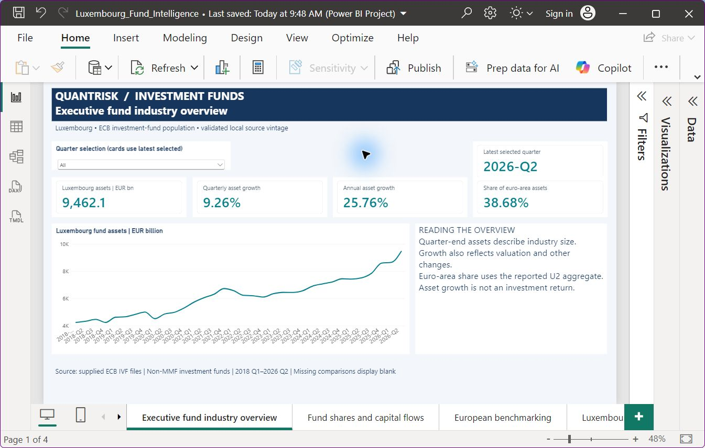

# Luxembourg Investment Fund Intelligence & Automated Reporting

QuantRisk Analytics portfolio project #3 demonstrates investment-fund industry analysis, European benchmarking and controlled reporting automation.

**Validated analytical MVP:** 850 ECB observations, 57 CSSF monthly records and 32 structural leaf cells. Two pipeline runs each passed 51 independent checks; all seven analytical tables reproduced exactly. The four-page Power BI report passed ten scoped Desktop acceptance checks. Six fault-injection tests also passed. See reports/power_bi/README.md for the acceptance boundary.

## Findings from the supplied data

- Luxembourg ECB total fund assets: EUR 9.462 trillion at 2026 Q2; quarterly growth 9.26%; annual growth 25.76%.
- Luxembourg share of euro-area assets: 38.68%, using the reported changing-composition aggregate.
- Net issuance: EUR 32.083 billion; separately reported transactions: EUR 78.508 billion. The difference is retained and explained as a methodological reconciliation item.
- CSSF August 2026: 2,961 UCIs and EUR 6,790.699 billion net assets, on a separate reporting perimeter.

Asset growth is not an investment return. This demonstration does not claim individual-fund insights, customer savings, paying clients or regulatory approval.

## Reproduce

Install requirements.txt, place the three specified files in data/raw, then run:

```text
python src/pipeline.py
python src/validation/validate.py
python src/build_power_bi.py
```

The pipeline never downloads source data. Versioned output folders and an atomic latest-validated pointer protect previous results. The Power BI builder creates a PBIP report tied to the selected validated run; open it in Desktop and refresh.

## Dashboard preview



## Documentation

- [Project charter](PROJECT_CHARTER.md)
- [Source evidence](docs/data_sources/source_inventory.md)
- [Physical schema and grain](docs/data_sources/source_schema_map.md)
- [KPI methodology](docs/methodology/initial_kpi_plan.md)
- [Independent validation](docs/validation/validation_summary.md)
- [Reproduction guide](docs/reproduction.md)
- [Technical and commercial case study](reports/executive/technical_case_study.md)
- [Power BI guide and acceptance](reports/power_bi/README.md)

Executive reports are dated and retained in reports/executive. Source files and large generated data remain local. A public repository is prepared separately and requires owner approval before creation or publication.

ANALYSE → AUTOMATE → TRAIN.
